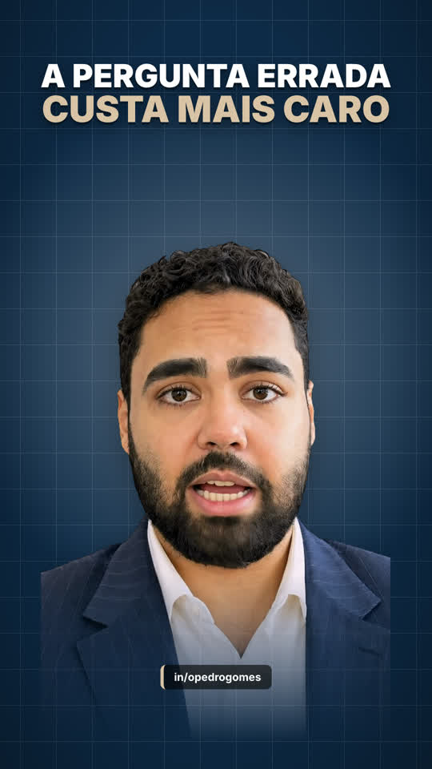

# shorts-medico

Skill para o [Claude Code](https://claude.com/claude-code) que transforma um tema de saúde num **Short/Reels/TikTok
de médico pronto para publicar**: o avatar do próprio médico (HeyGen) falando com a voz clonada dele (ElevenLabs),
recortado na frente de gráficos animados, com legenda palavra a palavra, capa no primeiro quadro, CTA de comentário,
checagem do CFM e o texto de publicação.

<p align="center">
  <a href="demo/demo.mp4"></a><br>
  <sub>Clique para ver o Short de demonstração (51 s), feito do começo ao fim com a skill.</sub>
</p>

## O que sai pronto
- **MP4 9:16** (1080×1920, 45–57 s) com o médico recortado (fundo verde) na frente de cenas que se alternam:
  número que conta, ícones "3 em cada 10", barras, estudo com marca-texto, mito × verdade, lista, frase grande.
  Todo dado aparece com a **fonte na tela**.
- **Capa no 1º quadro**: rosto ocupando ~42% da tela, reagindo ao título em cima. É o que aparece no feed.
- **Identificação do CFM** (nome · MÉDICO · CRM-UF · especialidade · RQE) no vídeo e na legenda.
- **CTA** convidando o público a contar a própria experiência nos comentários, e **loop** de volta à capa.
- **Capa PNG** e **texto de publicação**: título, descrição pensada para busca, hashtags, comentário fixado,
  aviso de IA, passo a passo por rede e o que olhar nas primeiras 48 h.
- **Retenção medida** antes de entregar: ritmo de novidades, tempo parado, tempo em close, silêncios, volume da trilha.

## Como funciona
1. Você pede: *"faz um short de médico sobre &lt;tema&gt;"* (ou dá um artigo seu como base).
2. O Claude escreve o roteiro, confere contra as regras do CFM e só segue com o seu "pode".
3. Ele gera o `para_gerar.txt` com o texto exato. Você cria a voz no **ElevenLabs** e o vídeo no **HeyGen**
   (9:16, 1080p, **fundo verde #00FF00**) e entrega o MP4.
4. A skill recorta, monta as cenas, sincroniza a legenda, mixa trilha e efeitos, renderiza, mede e entrega.

A skill **não acessa suas contas**. Voz e vídeo você gera nos próprios sites.

## O que você precisa
- Claude Code
- Node.js 22+, ffmpeg, Python 3.10+ (macOS: `brew install node ffmpeg python`)
- **ElevenLabs** com a voz do médico clonada (Instant ou Professional Voice Clone)
- **HeyGen** com o avatar do médico (Digital Twin / Instant Avatar gravado por ele)
- ~2 GB livres (modelo de transcrição em português)

## Instalar
No Claude Code:

```
/plugin marketplace add Gomes287/shorts-medico
/plugin install shorts-medico@shorts-medico
```

Depois peça *"faz um short de médico sobre ..."*. Na primeira vez a skill roda o `setup.sh` (uns minutos) e faz a
**configuração guiada**: nome, CRM, UF, especialidade e RQE, @, cores (pode mandar um print do seu perfil ou logo e
ela tira a paleta) e fonte do título, com uma **prévia da capa** para você aprovar.

Sem o sistema de plugins: baixe o ZIP, copie `skills/shorts-medico` para `~/.claude/skills/shorts-medico` e rode
`bash ~/.claude/skills/shorts-medico/tools/setup.sh`.

Seus dados ficam só no seu computador, em `~/.config/shorts-medico/` (perfil e as suas regras em `notas.md`).

## Dicas para o avatar e a voz
- **HeyGen:** grave o Digital Twin com boa luz no rosto, enquadramento do peito para cima e olhando para a câmera.
  Na geração, escolha fundo de cor sólida **verde #00FF00**. Recortar o fundo por IA fica bem pior.
- **ElevenLabs:** grave de 1 a 3 minutos da sua voz natural, sem ruído. Ao gerar, ouça uma vez: se errar o nome de
  um remédio ou sigla, avise o Claude que ele ajusta a grafia falada.
- No HeyGen, envie o **MP3 do ElevenLabs** como áudio, em vez de digitar o texto.

## Responsabilidade (CFM)
A skill confere o roteiro contra as Resoluções CFM 2.336/2023 (publicidade médica) e 2.454/2026 (uso de IA), mas
**não é parecer jurídico**: o médico é o responsável pelo que publica. Marque o conteúdo como feito com IA na
plataforma e mantenha a identificação com CRM. Os detalhes estão em `skills/shorts-medico/referencia/cfm.md`.

## Créditos e licenças
- Código da skill: **MIT**, © 2026 Pedro Gomes (`LICENSE`). Partes adaptadas de duas skills MIT de
  Matheus ([@celticmatheus1](https://www.youtube.com/@celticmatheus1)): motion-graphics-v3 (efeitos sonoros, método
  de medir o vídeo) e mapa-de-dados (trilha por código, regra da fonte na tela).
- **Vídeo e capa de demonstração (`demo/`) não fazem parte da licença MIT**: imagem, voz e conteúdo de
  Pedro Gomes, todos os direitos reservados.
- Fontes em `kit/fonts/` (Anton, Archivo Black, Inter, Playfair Display): SIL Open Font License 1.1, licença ao lado
  de cada fonte.
- Baixados na sua máquina, não incluídos: [HyperFrames](https://www.npmjs.com/package/hyperframes) (Apache-2.0),
  [GSAP](https://gsap.com) (Standard License da GreenSock), faster-whisper (MIT), OpenCV (Apache-2.0), ffmpeg (LGPL/GPL).
- ElevenLabs e HeyGen são serviços de terceiros, usados com a sua conta e sob os termos deles. Este projeto não tem
  ligação com essas empresas.
